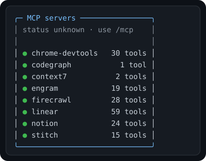

<div align="center">
  

# MCP Sidebar for Pi

**See the MCP tools available to your Pi session without leaving the conversation.**

[](https://github.com/badlogic/pi-mono)
[](https://github.com/Gentleman-Programming/gentle-shell)
[](LICENSE)

</div>

> [!IMPORTANT]
> In compatible Gentle Shell fullscreen sessions, MCP follows the native rail visibility. Gentle
> Shell 4.6 and newer render it as a section on the shared IDE panel surface; older compatible
> releases retain the standalone framed card. Plain Pi and incompatible hosts use the passive
> overlay fallback.

<div align="center">
  
  <br />
  <sub>Sanitized vector crop transcribed from a live Pi 1.2.0 TUI session.</sub>
</div>

## Quick start

```bash
pi install git:github.com/oniricosistemas/mcp-sidebar
```

Restart Pi or gentle-shell. The panel appears automatically in interactive TUI sessions.
Toggle it at any time with:

```text
/mcp-sidebar
```

In fullscreen mode, click a namespace row to open its tool names and descriptions.
The keyboard path works in every interactive TUI mode:

```text
/mcp-tools
/mcp-tools context7
```

Use arrow keys or Page Up/Page Down to scroll tool details and Escape to close them.
The sidebar and details dialog use semantic colors from the currently selected Pi theme.

Collapse or expand the panel by clicking its header, running:

```text
/mcp-sidebar-collapse
```

or pressing `Ctrl+Shift+M`. Some legacy terminals cannot distinguish that modified key,
so the command is the reliable fallback. `/mcp-sidebar` continues to hide or show the panel
without changing its collapsed state.

Use Pi's built-in `/mcp` screen for authoritative connection details,
authentication, reconnection, and configuration.

## What it shows

| Signal | Meaning |
|---|---|
| `tools registered` | Pi currently exposes one or more tools from this MCP namespace. |
| `<server> · ready` (also `connecting`, `error`, `disabled`) | The runtime's sanitized MCP status snapshot for that namespace, shown only when the Pi build exposes `pi.getMcpStatus()` and `pi.onMcpStatusChanged()`. |

Without that API nothing is shown: the panel reports inventory only and never infers connection
health from registered tools; the `/mcp` guidance above stays authoritative. Gentle Shell documents
the status API and its compatibility notes in
[`docs/mcp-status.md`](https://github.com/Gentleman-Programming/gentle-shell/blob/main/docs/mcp-status.md).

## Design goals

- **Glanceable:** server namespaces and tool counts fit in a compact panel.
- **Non-blocking:** neither the native rail participant nor the overlay fallback captures editor focus.
- **Responsive:** Gentle Shell stacks legacy cards or joins the 4.6+ shared panel surface, and hides the participant with the native rail at narrow widths; standalone Pi retains the overlay.
- **Collapsible:** header click, `/mcp-sidebar-collapse`, and `Ctrl+Shift+M` reduce MCP to a two-line framed card on legacy hosts or one native section header on the 4.6+ panel.
- **Theme-aware:** frame, text, selection, and details colors follow the active Pi theme.
- **Inspectable:** fullscreen row clicks and `/mcp-tools` reveal tool names and descriptions.
- **Honest:** connection status comes only from the runtime's sanitized snapshot; inventory never implies health, and builds without the status API show no status at all.

## Local development

Requirements: Node.js 22.19 or newer, pnpm 11, and Pi 1.2 or newer.

```bash
git clone https://github.com/oniricosistemas/mcp-sidebar.git
cd mcp-sidebar
pnpm install
pnpm check
pi -e .
```

## Architecture

```text
src/
├── extension.ts              # Pi lifecycle, commands, and presentation switching
├── gentle-shell-adapter.ts   # Guarded native-rail integration and stacked participants
├── mcp-view-model.ts         # MCP namespace discovery and honest labels
├── sidebar.ts                # Width-safe TUI rendering and row interaction
└── tool-details.ts           # Scrollable namespace tool descriptions
```

The extension observes Pi's public tool inventory. Because built-in MCP connections register tools
asynchronously, it samples that inventory once per second and renders only when it changes.

When the runtime exposes the sanitized MCP status API documented by Gentle Shell
(`pi.getMcpStatus()` / `pi.onMcpStatusChanged()`), the panel joins that snapshot per namespace and
re-renders on its change events; builds without both methods get no status display at all.

Gentle Shell integration is feature-detected through its terminal-owned rail state. The adapter
composes the existing Status footer by identity, routes mouse coordinates using actual rendered
heights, and restores the prior owner on disposal. A footer that declares `surface: "panel"` selects
the borderless 4.6+ section renderer while an older footer keeps the framed card, so compatibility
does not depend on parsing a package version. While that compatible wrapper remains mounted, MCP
follows the Status rail's visibility, including narrow-width hiding. The passive overlay is used only
when the integration is absent, incompatible, disposed, or replaced by a newer owner.

## Roadmap

> 📽️ **Presentación social:** el deck interactivo, el PDF, los carruseles por plataforma y el copy
> para LinkedIn/X/Discord están en [`presentation/`](presentation/README.md). Todo local, listo para
> publicar con autorización explícita.

- [x] Project and package foundation
- [x] Responsive passive sidebar MVP
- [x] Runtime screenshots and visual tuning
- [x] Feature-detected Gentle Shell rail stacking with standalone fallback
- [ ] Upstream proposal for a documented native sidebar slot
- [ ] Upstream proposal for sanitized MCP status events

## Gentle AI attribution

This extension was designed and developed with
[Gentle AI / gentle-shell](https://github.com/Gentleman-Programming/gentle-shell).
The Gentle Shell logo remains an upstream asset and does not imply endorsement.
See [Third-party notices](THIRD_PARTY_NOTICES.md) for provenance and license text.

## License

The project source is available under the [MIT License](LICENSE).
