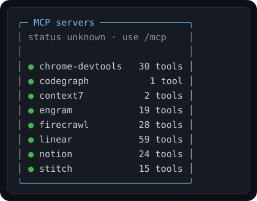

<div align="center">
  

# MCP Sidebar for Pi

**See the MCP tools available to your Pi session without leaving the conversation.**

[](https://github.com/badlogic/pi-mono)
[](https://github.com/Gentleman-Programming/gentle-shell)
[](LICENSE)

</div>

> [!IMPORTANT]
> This project is an early MVP. Pi currently exposes overlays, not a width-reserving sidebar slot,
> so the panel behaves as a responsive right-side overlay.

<div align="center">
  
  <br />
  <sub>Sanitized vector crop transcribed from a live Pi 1.2.0 TUI session.</sub>
</div>

## Quick start

```bash
pi install git:github.com/oniricosistemas/mcp-sidebar
```

Restart Pi or gentle-shell. The panel appears automatically in interactive TUI sessions.
Toggle it at any time with:

```text
/mcp-sidebar
```

Use Pi's built-in `/mcp` screen for authoritative connection details,
authentication, reconnection, and configuration.

## What it shows

| Signal | Meaning |
|---|---|
| `available` | Pi currently exposes one or more tools from this MCP namespace. |
| `status unknown` | Pi's public extension API cannot prove the transport is connected. |

The extension deliberately avoids claiming a server is connected when it can only see
registered tools. It also leaves Pi's built-in `/mcp` command untouched.

## Design goals

- **Glanceable:** server namespaces and tool counts fit in a compact panel.
- **Non-blocking:** the overlay does not capture keyboard focus.
- **Responsive:** narrow terminals fall back without covering the editor.
- **Theme-aware:** colors follow the active Pi theme.
- **Honest:** availability is reported separately from connection health.

## Local development

Requirements: Node.js 22.19 or newer, pnpm 11, and Pi 1.2 or newer.

```bash
git clone https://github.com/oniricosistemas/mcp-sidebar.git
cd mcp-sidebar
pnpm install
pnpm check
pi -e .
```

## Architecture

```text
src/
├── extension.ts       # Pi lifecycle and /mcp-sidebar command
├── mcp-view-model.ts  # MCP namespace discovery and honest labels
└── sidebar.ts         # Width-safe TUI rendering
```

The MVP observes Pi's public tool inventory. Because built-in MCP connections register tools
asynchronously, the extension samples that inventory once per second and renders only when it
changes. A future native version can use a width-reserving layout slot and sanitized MCP
runtime-status subscription if Pi exposes them.

## Roadmap

- [x] Project and package foundation
- [x] Responsive passive sidebar MVP
- [x] Runtime screenshots and visual tuning
- [ ] Upstream proposal for a native sidebar slot
- [ ] Upstream proposal for sanitized MCP status events

## Gentle AI attribution

This extension was designed and developed with
[Gentle AI / gentle-shell](https://github.com/Gentleman-Programming/gentle-shell).
The Gentle Shell logo remains an upstream asset and does not imply endorsement.
See [Third-party notices](THIRD_PARTY_NOTICES.md) for provenance and license text.

## License

The project source is available under the [MIT License](LICENSE).
